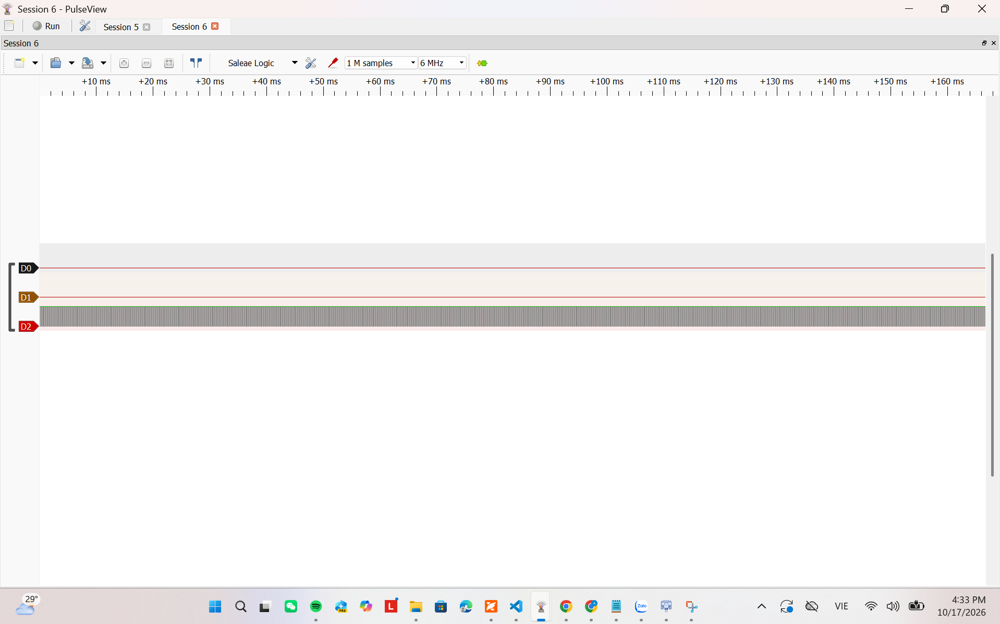
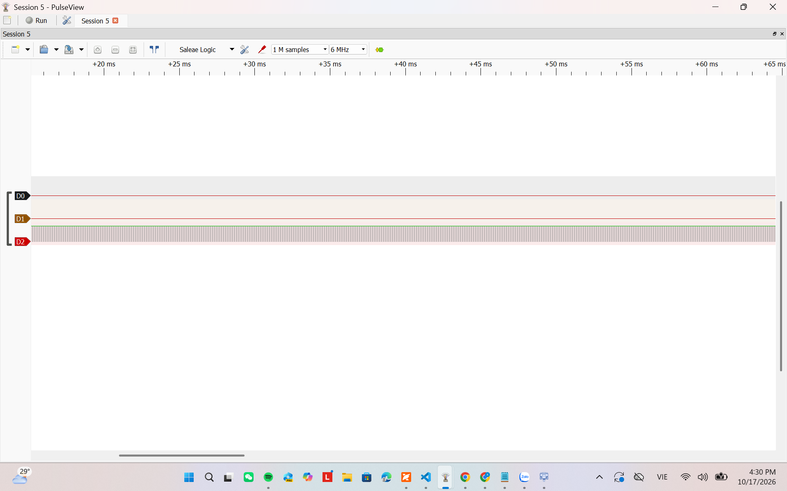
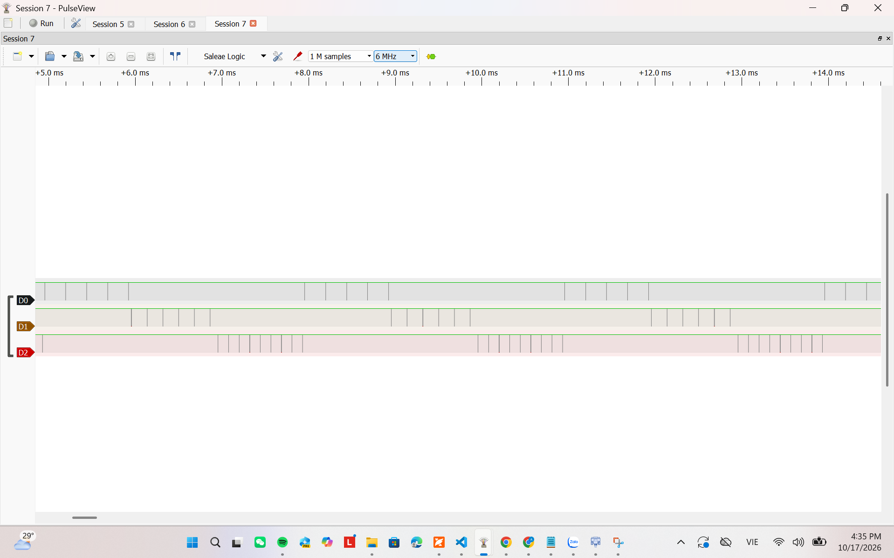
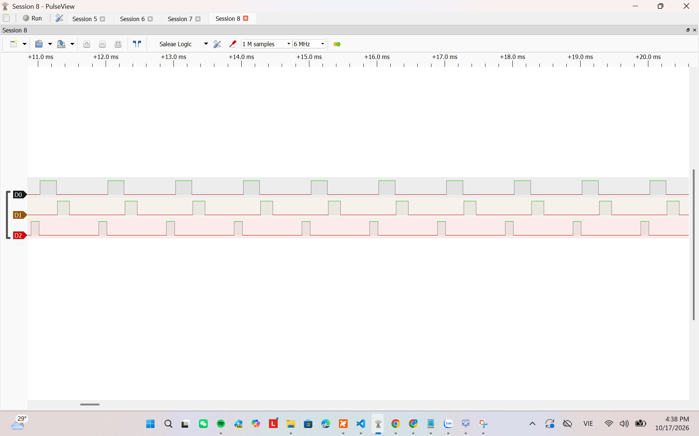
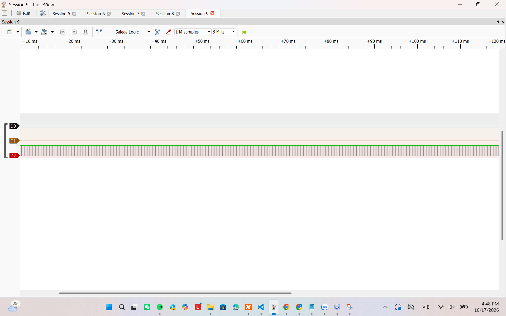

# Report — Week 1 / Ex2

`student_id`: 2412477    Commit của PREDICTION.md: d2bc44a48dbcafe8e8d4dc2b14940254de6fa097

## 1. CPU share đo được
| Cấu hình | A (%) | B (%) | C (%) | Time slice đo được | Ảnh |
|---|---|---|---|---|---|
| B2: preempt=1, ưu tiên khác nhau | `0` | `0` | `100` | — |  |
| B3: preempt=0, ưu tiên khác nhau | `0` | `0` | `100` | — |  |
| B4: preempt=1, cùng ưu tiên | `33.3` | `33.3` | `33.3` | `≈ 1.000 ms` |  |
| B5: sau khi sửa starvation | `≈ 24.0` | `≈ 18.0` | `≈ 12.0` | — |  |

Cách tính CPU share: chọn cùng một cửa sổ thời gian `T`, cộng thời gian CPU
thuộc về task và tính `share_i = 100 × CPU_time_i / T`. Ở B4, pin của task
bị preempt có thể còn HIGH, nên dùng các mốc task mới bắt đầu chạy để chia
time slice thay vì cộng trực tiếp duty cycle HIGH.

- B4: chọn cửa sổ từ khoảng `5 ms` đến `14 ms` gồm ba vòng round-robin.
  Mỗi task nhận tổng cộng khoảng `3 ms`, nên share của mỗi task là
  `3 / 9 × 100 ≈ 33.3%`.
- B5: trong mỗi chu kỳ `1 ms`, độ rộng xung đo được xấp xỉ A=`240 us`,
  B=`180 us`, C=`120 us`; do đó phần busy-work quan sát được lần lượt là
  `24%`, `18%`, `12%`. Khoảng `46%` còn lại là Idle và overhead của lời gọi
  HAL/kernel. Các số này là share của vùng GPIO HIGH đại diện cho busy-work,
  không bao gồm toàn bộ chi phí thực thi của task.

## 2. Preemption nhìn thấy ở đâu
Trên ảnh **bước 4** (cùng ưu tiên, round-robin), chỉ ra ít nhất **2 thời điểm**
preemption xảy ra. Với mỗi thời điểm: dấu thời gian, task bị cắt, task chiếm CPU,
và vì sao (hết time slice, không phải block).

| t (us) | Task bị preempt | Task chiếm CPU | Lý do |
|---|---|---|---|
| `≈ 6000` | A | B | Hết time slice 1 ms |
| `≈ 7000` | B | C | Hết time slice 1 ms |

Các timestamp trên được đọc tương đối theo trục thời gian của ảnh B4. Cụm cạnh
GPIO chuyển từ D0 sang D1 ở khoảng `6 ms`, rồi từ D1 sang D2 ở khoảng `7 ms`.
Pin của task bị cắt có thể vẫn giữ HIGH; vì vậy cụm cạnh đang hoạt động, không
chỉ mức logic tức thời, mới cho biết task nào đang chiếm CPU.

Ở **bước 2** (ưu tiên khác nhau, đều busy-loop không block): giải thích vì sao ảnh
của bạn cho thấy **0 thời điểm preemption**, dù chạy bao lâu đi nữa — dựa vào điều
kiện preemption của FreeRTOS, không phải "vì ảnh chụp chưa đủ dài".

Ở B2, C có priority 3 và luôn ở trạng thái Running hoặc Ready vì không gọi
API block. A và B có priority thấp hơn nên không bao giờ được chọn. Preemption
chỉ xảy ra nếu xuất hiện một task Ready có priority cao hơn task đang chạy;
không có task nào cao hơn C, vì vậy ảnh có 0 lần preemption dù capture bao lâu.

## 3. Time slice
Time slice đo được ở bước 4: `≈ 1.000 ms`. `configTICK_RATE_HZ` = 1000 Hz.

Time slice lý thuyết là `1000 / 1000 = 1 ms`. Sai số:

`100 × abs(1.000 ms - 1 ms) / 1 ms ≈ 0%`.

Logic analyzer được lấy mẫu ở `6 MHz`, tương ứng độ phân giải thời gian khoảng
`1 / 6 MHz ≈ 0.167 us`; không khẳng định sai số chính xác bằng 0 tuyệt đối.

Sai số đến từ độ phân giải logic analyzer, thời điểm cạnh GPIO so với tick và
thời gian chạy các lệnh GPIO/scheduler quanh biên chuyển task.

## 4. DWT wrap-around
`DWT->CYCCNT` là counter 32 bit. Với clock 72 MHz, thời gian wrap là
`2^32 / 72000000 ≈ 59.65 s`. Sau khi wrap về 0, phép so sánh tuyệt đối
`DWT->CYCCNT > target` không còn đúng. Code dùng phép trừ unsigned modulo:

```c
while ((uint32_t)(DWT->CYCCNT - start) < cycles) {
}
```

Cách này vẫn cho elapsed cycles đúng khi counter đi qua điểm wrap, miễn khoảng
đo nhỏ hơn một vòng counter.

## 5. Sửa starvation
Cách em chọn: gọi `vTaskDelay(pdMS_TO_TICKS(1))` sau mỗi lần làm việc.

Nó chuyển task hiện tại từ Running sang Blocked tới tick kế tiếp. Khi C bị
block, A có thể chạy; khi A cũng block, B có thể chạy. `taskYIELD()` không đủ
vì nó chỉ nhường cho task Ready cùng priority, trong khi A/B thấp hơn C.

Đánh đổi: tăng latency, giảm throughput, để CPU có thời gian Idle và tăng số
lần context switch. Đổi lại, mọi task đều có cơ hội tiến triển.

## 6. Lệch so với dự đoán
| Mục | Dự đoán | Đo được | Giải thích |
|---|---|---|---|
| B2 | A=0%, B=0%, C=100% | A=0%, B=0%, C=100% | Khớp: C có priority cao nhất và không block nên A, B bị starvation. |
| B3 | Gần giống B2 | A=0%, B=0%, C=100% | Khớp: cooperative scheduling không ép C nhường CPU; C cũng không block/yield. |
| B4 time slice | 1 ms | ≈ 1.000 ms | Khớp với một tick ở `configTICK_RATE_HZ=1000 Hz`; ba task luân phiên A→B→C. |
| B5 | Cả ba task đều chạy | A≈24%, B≈18%, C≈12% | Khớp: `vTaskDelay(1 tick)` làm từng task block, nên cả ba đều tiến triển; phần thời gian còn lại thuộc Idle/overhead. |

## 7. Câu hỏi đánh đổi
Với **bộ ưu tiên của bạn**, nếu `TASK_C_WORK_US` tăng gấp 3 lần thì bảng CPU share ở
bước 2 thay đổi thế nào? Trả lời bằng số suy ra từ dữ liệu của bạn, rồi **đo lại để
kiểm chứng**. Nếu lệch, giải thích.

C tăng từ 120 us lên 360 us nhưng vẫn là task priority cao nhất và không block,
nên dự đoán CPU share không đổi: A=0%, B=0%, C=100%. Độ rộng mỗi pulse C tăng
xấp xỉ ba lần. Ảnh đo C×3 xác nhận D0 và D1 phẳng, chỉ D2 chuyển mức liên tục:
A=`0`%, B=`0`%, C=`100`%; pulse C xấp xỉ `360 us` theo thời gian busy-work đã
cấu hình. Ảnh: . Do ảnh đang zoom rộng và không
có cursor, độ rộng pulse được ghi với dấu xấp xỉ thay vì coi là phép đo tuyệt đối.
