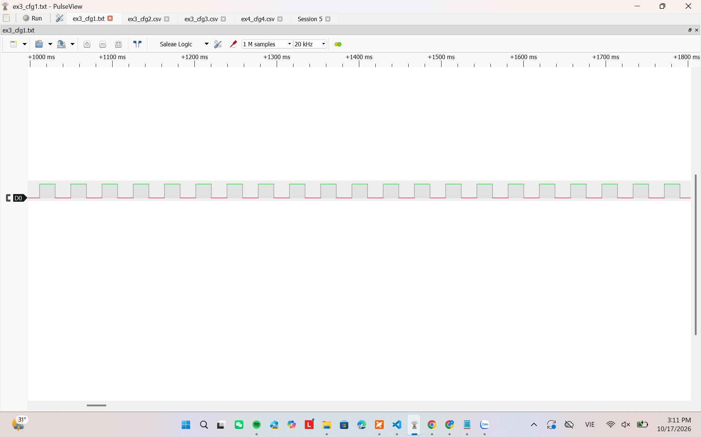
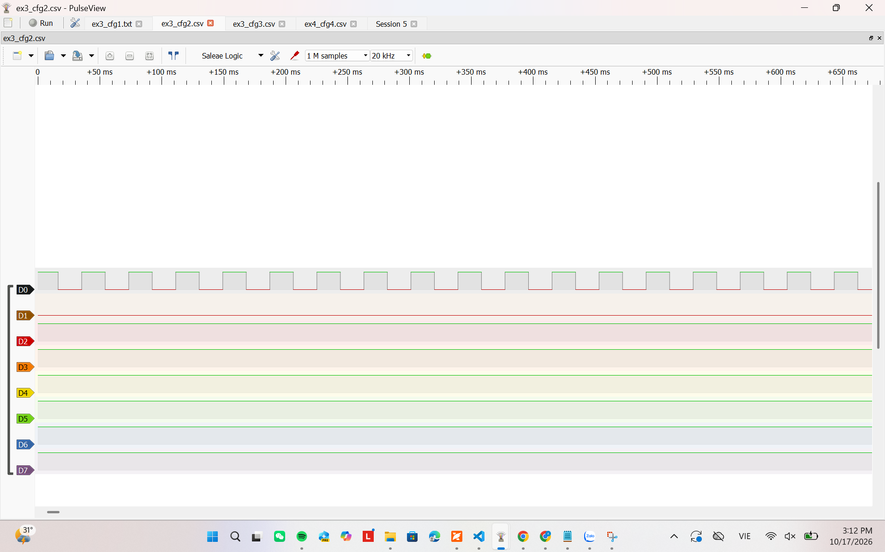
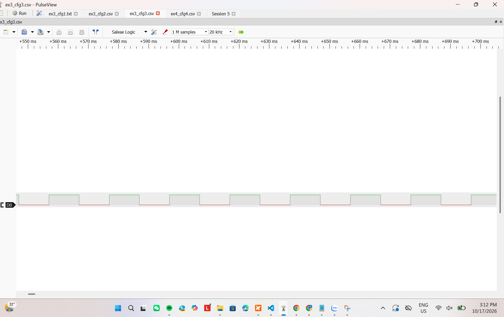

# Report — Week 1 / Ex3

`student_id`: 2412477    Commit của PREDICTION.md:  7b79a0506265e886d2738a2d39e49440c947be0d

## 1. Bảng thống kê (tính từ CSV, không đọc tay)
| # | Delay | Tick | min (ms) | max (ms) | tb (ms) | jitter = max−min (us) | drift tổng (ms) |
|---|---|---|---|---|---|---|---|
| 1 | `vTaskDelay` | 1000 |18.950 | 19.000 |18.9940 |50 | −3|
| 2 | `xTaskDelayUntil` | 1000 |18.950 | 19.000| 18.9942| 50| −2.90|
| 3 | `vTaskDelay` | 100 | 9.950|10.000 |9.9969 | 50|−4501.55 |
| 4 | `xTaskDelayUntil` | 100 |9.950 |10.000 | 9.9969|50 |−4501.55 |

- Script dùng để tính: `python analyze_timing.py --sample-rate 20000 --period-ms 19 --count 500 "ex3_cfg1.csv" "ex3_cfg2.csv" "ex3_cfg3.csv" "ex3_cfg4.csv" `
- Kết quả thống kê: [ex3_statistics.csv](doc_csv/ex3_statistics.csv)
- CSV gốc: `______` (commit kèm)
- Ảnh logic analyzer:
  - 
  - 
  - 
  - 

## 2. Tại sao `vTaskDelay` bị drift
Công thức drift theo `PERIOD_MS` và `WORK_JITTER_US` của **bạn**, rồi so với số đo:
Thời gian xử lý trung bình của work_jitter_us là 600/2 = 300us => sau 500 count thì task sẽ bị chậm 500 x 0.3 = 150ms
| | Tính theo công thức | Đo được | Lệch |
|---|---|---|---|
| Drift tổng (ms) | 150ms | -3.00 ms|-153.00 ms|

Vì WORK_JITTER_US = 600 µs < 1 tick = 1 ms; task thường hoàn thành work trước tick kế tiếp nên phần work được hấp thụ trong cùng tick. Vì vậy mô hình dự đoán +150 ms không xuất hiện trong số đo.
## 3. Tại sao tick 100 Hz sai nhiều hơn
`PERIOD_MS` = 19 ; một tick = 10 ms. Chứng minh bằng số đo, không bằng lý thuyết:
Khi chúng ta chia 19/10 = 1.9 thì sẽ bị làm tròn xuống 1 => lúc đó cpu sẽ đếm là 1 tick thay vì 1.9 tick tư đó bị mất 0.9 tick
\[
pdMS\_TO\_TICKS(19)=\lfloor19\times100/1000\rfloor=1
\]
\[
1\ tick=10\ ms
\]
## 4. `xTaskDelayUntil` trả về gì
Giá trị trả về nghĩa là gì, và trong 4 lần chạy của bạn nó có bao giờ báo
"đã trễ deadline" không? Bao nhiêu lần / `SAMPLE_COUNT`?
có thể trả về pdTRUE là task thực sự bị block và đợi tới lần tiếp theo or pdFALSE thời điểm đã đến or vượt qua task k thể delay => trễ deadline

- Cấu hình 2, tick 1000 Hz: `g_deadline_miss_count = 0/500`.
- Cấu hình 4, tick 100 Hz: `g_deadline_miss_count = 0/500`.
Vì chu kỳ jitter quá nhỏ chỉ khoảng 600us nhỏ hơn rất nhiều sau với cả chu kỳ 19ms và 10ms => dường như gần bằng 0 khi thời gian work quá nhỏ.
## 5. Lệch so với dự đoán
Mỗi dòng lệch trong bảng → lệch bao nhiêu + nguyên nhân vật lý.
| Cấu hình | Dự đoán | Đo được | Nhận xét |
|---|---:|---:|---|
| `vTaskDelay`, 1000 Hz | 19 ms, drift +150 ms | 18.9940 ms, drift -3.00 ms | Work dưới 1 tick nên phần lớn được hấp thụ trong cùng tick |
| `xTaskDelayUntil`, 1000 Hz | 19 ms, drift 0 ms | 18.9942 ms, drift -2.90 ms | Gần dự đoán; sai số chủ yếu do lấy mẫu và clock |
| `vTaskDelay`, 100 Hz | 10 ms, drift -4500 ms | 9.9969 ms, drift -4501.55 ms | Lệch lý thuyết 1.55 ms |
| `xTaskDelayUntil`, 100 Hz | 10 ms, drift -4500 ms | 9.9969 ms, drift -4501.55 ms | Lệch lý thuyết 1.55 ms |
## 6. Câu hỏi đánh đổi
Tick 1000 Hz cho độ chính xác tốt hơn nhưng **tốn** gì? Dựa vào dữ liệu của bạn:
đo CPU overhead của tick ISR ở 100 Hz và 1000 Hz (gợi ý: cho một task ưu tiên thấp
nhất đếm vòng lặp trong 1 giây, so sánh 2 cấu hình). Điền số:
Ở tick rate 1000 Hz, task đếm thực hiện ít hơn 7,651 vòng mỗi giây so
với cấu hình 100 Hz. Mức giảm tương đối là khoảng 0.224%. Nguyên nhân
là tick 1000 Hz phát sinh số lần ngắt SysTick nhiều gấp 10 lần, khiến
CPU dành thêm thời gian xử lý tick ISR và scheduler.
| Tick rate | Số vòng lặp idle đếm được trong 1 s | Overhead suy ra |
|---|---:|---:|
| 100 Hz | 3,414,579 | 0% (mốc so sánh) |
| 1000 Hz | 3,406,928 | 0.224% tăng thêm |

Với ứng dụng `PERIOD_MS` = 19ms của bạn, bạn chọn tick rate nào? Bảo vệ bằng số trên.
Với PERIOD_MS = 19 ms, tôi em tick rate 1000 Hz. Mặc dù overhead đo
được tăng khoảng 0.224%, cấu hình này biểu diễn chính xác 19 ms. Ở
100 Hz, pdMS_TO_TICKS(19) chỉ bằng 1 tick, tương đương 10 ms, gây sai
số chu kỳ -47.37% và drift khoảng -4.5 giây sau 500 chu kỳ.
