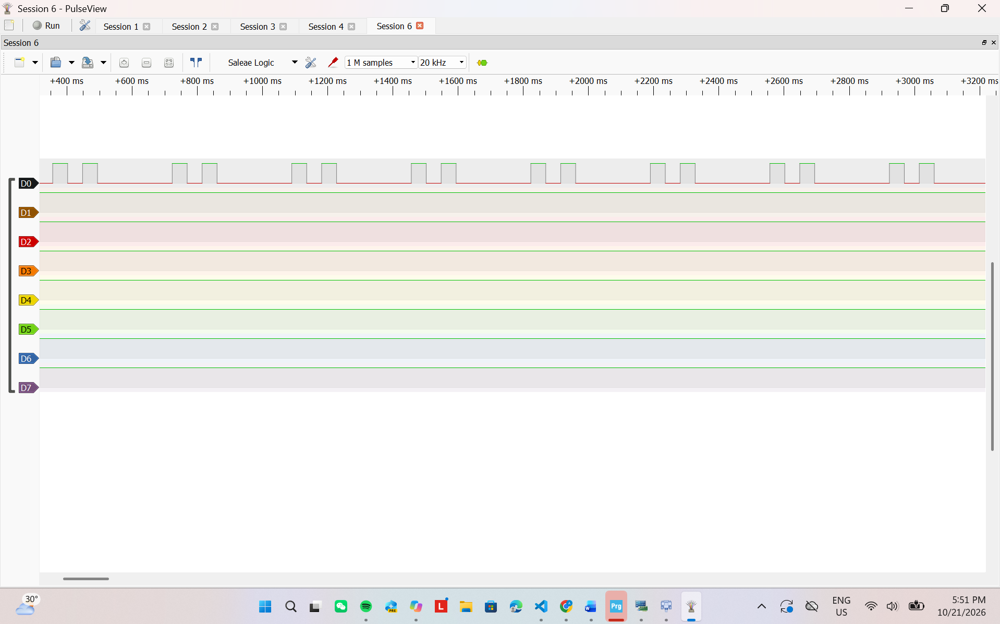

# Report — Week 1 / Ex4

`student_id`: 2412477

Commit của `PREDICTION.md`: `dda0511`

## 1. Ngân sách RAM từ `.map`

| Mục | Symbol/section trong `.map` | Bytes |
|---|---|---:|
| `.data` | `.data`, size `0x10` | 16 |
| `.bss` không kể heap | `.bss` `0x291c` − `.bss.ucHeap` `0x2000` | 2332 |
| Heap FreeRTOS | `.bss.ucHeap`, size `0x2000` | 8192 |
| Stack main (MSP) | `_Min_Stack_Size = 0x400` | 1024 |
| Còn lại/chưa dùng | phần còn lại để đủ SRAM 20 KB | 8916 |
| **Tổng** | RAM length `0x5000` | **20480** |

Kiểm tra tổng:

`16 + 2332 + 8192 + 1024 + 8916 = 20480 bytes`.

Mục 8916 bytes gồm `_Min_Heap_Size = 512 bytes`, 4 bytes căn chỉnh và
8400 bytes chưa được vùng nào giữ. Đoạn trích map dùng để tính bảng nằm tại
[`evidence/ram_map_excerpt.txt`](evidence/ram_map_excerpt.txt).

## 2. Số đo lúc chạy

Log UART baseline, với stack `dyn_task` bằng 160 words:

```text
=== RAM REPORT ===
Free heap: 6072 bytes
Minimum ever free heap: 6072 bytes
HWM dyn_task: 124 words, 496 bytes
HWM stat_task: 104 words, 416 bytes
HWM ram_report: 286 words, 1144 bytes
HWM idle: 109 words, 436 bytes
HWM timer: 84 words, 336 bytes
```

| Đại lượng | Words | Bytes |
|---|---:|---:|
| `xPortGetFreeHeapSize()` | — | 6072 |
| `xPortGetMinimumEverFreeHeapSize()` | — | 6072 |
| HWM `dyn_task` | 124 | 496 |
| HWM `stat_task` | 104 | 416 |
| HWM `ram_report_task` | 286 | 1144 |
| HWM idle task | 109 | 436 |
| HWM timer task | 84 | 336 |

Heap còn trống đạt yêu cầu vì `6072 >= TARGET_FREE_HEAP_BYTES = 4096`.
Phần vượt yêu cầu là `6072 - 4096 = 1976 bytes`. Free heap và minimum-ever
bằng nhau vì sau khi tạo các task, chương trình không cấp phát động thêm.

## 3. Đối chiếu `.map` và runtime

Heap trong `.map` là 8192 bytes; `xPortGetFreeHeapSize()` là 6072 bytes;
chênh lệch là `8192 - 6072 = 2120 bytes`.

Với `sizeof(TCB_t) = 76`, header của `heap_4` bằng 8 bytes và alignment 8
bytes, phần chênh lệch gồm:

| Allocation | Payload | Header/padding | Heap đã dùng |
|---|---:|---:|---:|
| Stack `dyn_task` | 640 | 8 | 648 |
| TCB `dyn_task` | 76 | 12 | 88 |
| Stack `ram_report_task` | 1280 | 8 | 1288 |
| TCB `ram_report_task` | 76 | 12 | 88 |
| End marker/alignment ban đầu của `heap_4` | — | 8 | 8 |
| **Tổng** | | | **2120** |

`stat_task`, Idle task và Timer task dùng cấp phát tĩnh nên TCB và stack của
chúng nằm trong `.bss`, không làm giảm `xPortGetFreeHeapSize()`.

`.map` cho biết toàn bộ mảng `ucHeap[8192]` đã chiếm chỗ trong SRAM ngay từ
lúc link. API runtime cho biết tại thời điểm đo còn bao nhiêu byte bên trong
mảng đó chưa được allocator cấp phát. Vì vậy hai số đo có ý nghĩa khác nhau.

## 4. Dynamic và static

HWM của `dyn_task` và `stat_task` lệch `124 - 104 = 20 words`. Tuy nhiên HWM
là số stack **còn dư**, không phải số đã dùng. Chuẩn hóa theo stack được cấp:

- `dyn_task`: dùng cực đại `160 - 124 = 36 words`.
- `stat_task`: dùng cực đại `128 - 104 = 24 words`.

Hai task làm cùng loại công việc nhưng thời điểm bị ngắt, đường chạy sâu nhất
đã đi qua và stack frame tại thời điểm context switch có thể khác nhau. Cách
cấp phát động hay tĩnh không tự làm hàm task cần nhiều hoặc ít stack hơn.

`xTaskCreate()` lấy cả TCB và stack từ `ucHeap` của `heap_4`; ứng dụng chỉ
nhận lại handle. `xTaskCreateStatic()` không lấy hai vùng này từ heap: ứng
dụng phải cung cấp một `StaticTask_t` và một mảng `StackType_t[]`, đều nằm
trong `.bss` ở bài này. Vì thế `xTaskCreate()` trả `pdPASS/pdFAIL`, còn
`xTaskCreateStatic()` trả task handle hoặc `NULL`.

## 5. Tràn stack có chủ ý



Ảnh cho thấy D0/PA5 phát lặp lại từng cụm hai xung. Nó khớp với
`vApplicationStackOverflowHook()` gọi `error_blink(2U)`, nên đây là bằng
chứng hook stack overflow đã chạy. Mảng `volatile uint8_t
stack_hog[HOG_DEPTH_BYTES]` có 640 bytes, bằng toàn bộ stack 160 words của
`dyn_task`; task vẫn cần thêm stack cho context, biến vòng lặp và lời gọi hàm,
nên vùng biên stack bị ghi đè. `volatile` buộc compiler thực hiện các phép ghi.

Không gọi UART blocking trong hook vì stack của task vi phạm có thể đã hỏng.
UART blocking còn có thể chờ cờ phần cứng, timeout hoặc cơ chế phụ thuộc tick;
trong hook hệ thống không còn ở trạng thái lập lịch bình thường và interrupt
có thể đã bị khóa. Một lời gọi sâu còn sử dụng thêm chính stack đang hỏng.
Nếu UART tình cờ in được thì chỉ vì phần stack bị phá chưa chạm dữ liệu cần
thiết và UART đang sẵn sàng; đó không phải hành vi có thể đảm bảo. Ghi GPIO
trực tiếp và dừng hệ thống là cách báo lỗi đơn giản, dễ quan sát hơn.

## 6. Stack nhỏ nhất an toàn

| Lần thử | Stack (words) | HWM (words) | Kết quả |
|---|---:|---:|---|
| Baseline | 160 | 124 | An toàn nhưng cấp dư nhiều |
| Stack overflow | 160 | — | Tràn do mảng cục bộ 640 bytes |
| Safe-stack | 72 | 47 | An toàn, HWM lớn hơn 32 words |

Ở baseline, mức sử dụng cực đại quan sát được là `160 - 124 = 36 words`.
Cộng biên an toàn yêu cầu 32 words được 68 words; làm tròn lên bội số 8, giá
trị cuối cùng được chọn là **72 words**.

Khi chạy lại, HWM là 47 words, tức còn dư 188 bytes và lớn hơn biên yêu cầu
32 words. Hook không chạy và UART tiếp tục in ổn định. Free heap tăng đúng:

`6424 - 6072 = 352 bytes = (160 - 72) × 4`.

## 7. Sai lệch so với dự đoán

| Đại lượng | Dự đoán | Thực tế | Sai lệch và nguyên nhân |
|---|---:|---:|---|
| `.data` | 20 B | 16 B | −4 B; số biến khởi tạo khác ước lượng |
| `.bss` không kể heap | 2200 B | 2332 B | +132 B; có TCB/stack tĩnh Idle, Timer, `stat_task` và trạng thái kernel/HAL |
| RAM còn lại | 9044 B | 8916 B | −128 B; bù cho thay đổi `.data` và `.bss` để tổng vẫn bằng 20480 B |
| Free heap baseline | khoảng 6000 B | 6072 B | +72 B; TCB, header và alignment thực tế nhỏ hơn ước lượng tổng quát |
| HWM `dyn_task` | 96 words | 124 words | +28; task đơn giản dùng ít stack hơn dự đoán |
| HWM `stat_task` | 64 words | 104 words | +40; task đơn giản dùng ít stack hơn dự đoán |
| HWM Idle | 80 words | 109 words | +29; đường chạy Idle trong phép đo dùng ít stack hơn dự đoán |
| HWM Timer | 72 words | 84 words | +12; Timer daemon chưa xử lý callback phức tạp |
| Stack cuối `dyn_task` | 96 words | 72 words | −24; HWM thật cho thấy có thể giảm thêm mà vẫn giữ biên ít nhất 32 words |
| Overflow hook | Có thể chạy | Đã chạy | Khớp dự đoán; ảnh cho thấy mẫu hai xung |

Sai lệch HWM là bình thường vì dự đoán chưa biết chính xác stack frame do
compiler tạo và đường chạy sâu nhất. Kết luận cuối phải dựa trên HWM nhỏ nhất
quan sát được khi chạy đủ lâu, không chỉ dựa vào dự đoán.

## 8. Câu hỏi đánh đổi

Với `HEAP_SIZE_BYTES = 8192`, cần thêm một task có stack 128 words:

### Phương án 1: cấp phát động

- Stack payload: `128 × 4 = 512 bytes`.
- Block stack trong `heap_4`: `512 + 8 = 520 bytes`.
- Block TCB: `76 + 8`, căn lên 8 byte = 88 bytes.
- Handle lưu trong `.bss`: 4 bytes.
- Tổng RAM tăng: khoảng 612 bytes; trong đó FreeRTOS heap giảm 608 bytes.
- Free heap dự kiến: `6424 - 608 = 5816 bytes`, vẫn đạt mốc 4096 bytes.

Ưu điểm là có thể tạo/xóa task lúc chạy. Nhược điểm là tiêu thụ heap và có
nguy cơ phân mảnh nếu hệ thống thường xuyên tạo/xóa nhiều object khác cỡ.

### Phương án 2: cấp phát tĩnh

- Stack tĩnh: `128 × 4 = 512 bytes` trong `.bss`.
- `StaticTask_t`: 76 bytes trong `.bss`.
- Handle để đo HWM: 4 bytes trong `.bss`.
- Tổng `.bss` tăng: `512 + 76 + 4 = 592 bytes`.
- FreeRTOS heap dự kiến giữ nguyên 6424 bytes.

Em chọn **phương án 2** vì bảng ngân sách còn đủ SRAM tĩnh, kích thước task đã
biết trước và cách này giữ nguyên heap cho các object cần tạo động sau này.
Task được bật bằng `ADD_EXTRA_STATIC_TASK=1` và tạo bằng `xTaskCreateStatic()`.
Kết quả linker cũng tăng đúng `12672 - 12080 = 592 bytes` RAM.

Log đo lại:

```text
=== RAM REPORT ===
Free heap: 6424 bytes
Minimum ever free heap: 6424 bytes
HWM dyn_task: 47 words, 188 bytes
HWM stat_task: 104 words, 416 bytes
HWM ram_report: 286 words, 1144 bytes
HWM idle: 110 words, 440 bytes
HWM timer: 83 words, 332 bytes
HWM extra_task: 103 words, 412 bytes
```

Free heap vẫn là 6424 bytes, chứng minh stack và TCB của `extra_task` không
lấy từ `ucHeap`. HWM 103 words nghĩa là task dùng cực đại `128 - 103 = 25
words`, còn biên an toàn 103 words.
