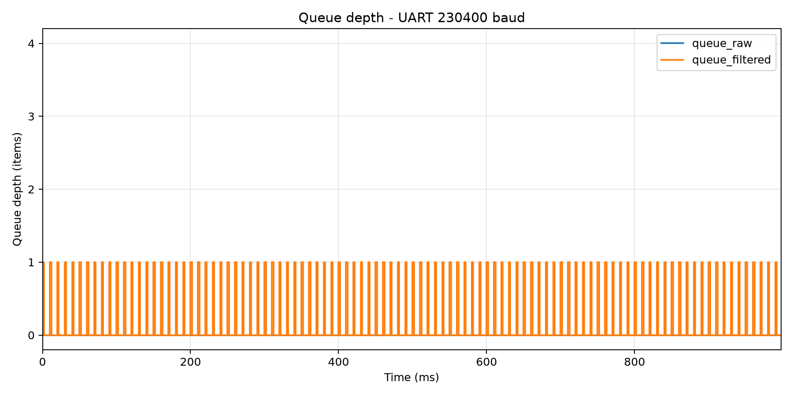
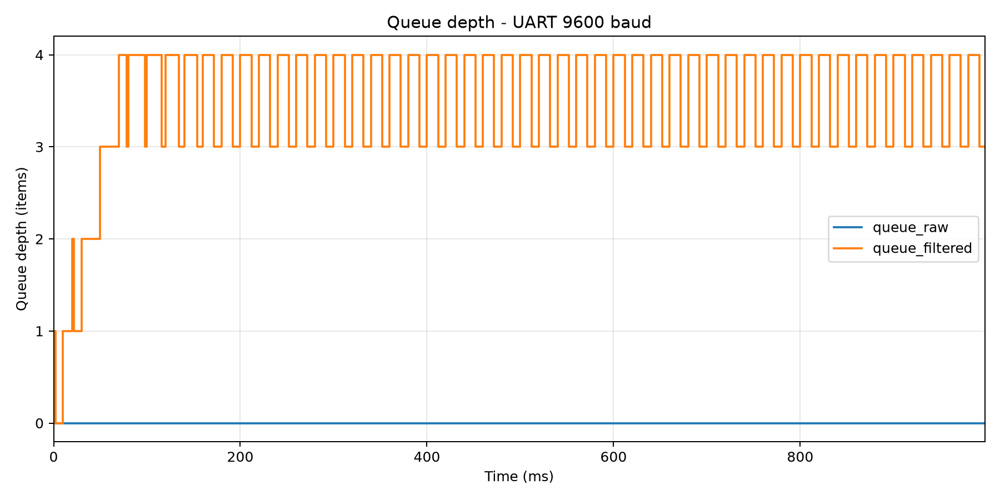

# Report — Week 2 / Ex1

`student_id`: 2412477    Commit của PREDICTION.md: `9f15e73`

## 1. Kích thước queue tối thiểu

| Queue | Dự đoán | Đo được | Khớp? |
|---|---:|---:|---|
| `queue_raw` | 1 | Logger quan sát cực đại 0; mẫu bị filter lấy ra ngay | Có, xem giải thích scheduling bên dưới |
| `queue_filtered` | 1 | 1 | Có |

Sensor tạo một mẫu mỗi `SAMPLE_PERIOD_MS = 10 ms`, nên:

`f_s = \frac{1000}{10} = 100\ \text{mẫu/s}`

Một dòng UART trong trường hợp xấu nhất có chiều dài khoảng 33 byte.
Với cấu hình 8N1, mỗi byte cần 10 bit:

`T_{UART} = \frac{33 \times 10}{230400} \approx 1.432\ \text{ms}`
Vì thời gian truyền UART nhỏ hơn chu kỳ tạo mẫu 10 ms, UART có thể
truyền xong một mẫu trước khi mẫu tiếp theo xuất hiện. Do đó dự đoán
queue tối thiểu là một phần tử cho cả hai queue.

Trong cửa sổ đo 1000 ms, sensor và filter xử lý 101 mẫu, UART nhận 100
mẫu. Các bộ đếm lỗi I2C, lỗi UART, drop tại hai queue và sequence gap
đều bằng 0.

Logger quan sát `queue_raw` luôn bằng 0. Nguyên nhân là `filter_task`
có priority cao hơn sensor và logger. Ngay khi sensor gửi một phần tử,
filter được đánh thức, preempt sensor và lấy phần tử khỏi queue trước
khi logger chạy. Điều này không có nghĩa queue không được sử dụng.
Queue vẫn cần tối thiểu một phần tử để truyền dữ liệu.

`queue_filtered` đạt độ sâu lớn nhất là 1 và có 100/500 lần lấy mẫu
quan sát thấy queue khác 0. Kết quả phù hợp với dự đoán rằng queue
không tích lũy trong cấu hình UART 230400 baud.

## 2. Đồ thị độ đầy queue theo thời gian

### Cấu hình bình thường — 230400 baud



Ở cấu hình bình thường, `queue_raw` luôn được logger quan sát ở mức 0.
`filter_task` có priority cao hơn và đang block chờ dữ liệu nên lấy phần
tử ra ngay sau khi sensor gửi.

`queue_filtered` dao động giữa 0 và 1, không tăng dần theo thời gian.
UART 230400 baud tiêu thụ dữ liệu nhanh hơn tốc độ filter tạo dữ liệu,
do đó queue không tích lũy và không có mẫu bị drop.

### Cấu hình UART chậm — 9600 baud



Khi hạ baud rate xuống 9600, thời gian truyền một dòng UART trong
trường hợp xấu nhất là:

`T_{UART,9600} = \frac{33 \times 10}{9600} \approx 34.375\ \text{ms}`

Giá trị này lớn hơn chu kỳ tạo mẫu 10 ms, do đó UART tiêu thụ dữ liệu
chậm hơn tốc độ filter tạo ra dữ liệu. `queue_filtered` tăng nhanh,
chạm độ sâu 4 tại khoảng `70 ms`, sau đó dao động gần
mức đầy.

`queue_raw` vẫn ở gần 0 vì `filter_task` dùng timeout 0. Khi
`queue_filtered` đầy, filter bỏ kết quả không gửi được thay vì block,
sau đó tiếp tục nhận mẫu tiếp theo từ `queue_raw`.


## 3. Khi nào queue đầy
Mô tả **chính xác** thời điểm `queue_filtered` bắt đầu đầy khi hạ baud, và số
mẫu bị mất/trễ (đếm bằng số thứ tự mẫu gắn trong payload).

Ở cấu hình 9600 baud và timeout bằng 0, `queue_filtered` lần đầu được
logger quan sát ở độ sâu 4 tại `70 ms`.

Trong cửa sổ đo 1000 ms:

- Filter xử lý `101` mẫu.
- UART nhận `51` mẫu.
- `46` lần gửi vào `queue_filtered` thất bại.
- UART phát hiện `42` sequence bị thiếu.
- `queue_raw` không mất mẫu (`g_raw_drop_count = 0`).

Các counter thỏa phương trình bảo toàn tại thời điểm pause:

```text
101 mẫu filter xử lý = 51 mẫu UART đã nhận
                     + 46 mẫu gửi thất bại
                     + 4 mẫu còn trong queue
```

`g_uart_gap_count = 42` nhỏ hơn 46 vì bốn mẫu mất cuối chưa thể hiện thành
sequence gap tại UART ở thời điểm pause. UART chỉ phát hiện một gap khi nó
nhận được một sequence mới nằm sau vùng đã bị mất.

Khi `queue_filtered` đầy, `xQueueSend(..., 0)` trả về thất bại ngay.
Filter tăng `g_filtered_drop_count` và mẫu đó không đến được UART.
Các khoảng nhảy trong trường `seq` cho phép UART phát hiện số mẫu bị
mất thông qua `g_uart_gap_count`.

## 4. Hành vi 3 kiểu timeout

| Timeout | Trạng thái khi queue đầy | Ảnh hưởng |
|---|---|---|
| `0` | Trả `errQUEUE_FULL` ngay, task không Blocked | Giữ chu kỳ filter nhưng bỏ payload hiện tại. Đây là mode đã đo: `g_filtered_drop_count = 46`. |
| Hữu hạn, ví dụ 5 ms | Task Blocked tối đa 5 tick; gửi thành công nếu có chỗ trước timeout, nếu không sẽ trả lỗi | Có thể giảm drop nhưng tăng latency và jitter. Với UART cần khoảng 18–34 ms/dòng, 5 ms thường vẫn chưa đủ. |
| `portMAX_DELAY` | Task Blocked cho đến khi queue có chỗ | Payload đang chờ không bị bỏ, nhưng backpressure truyền về `queue_raw`; filter không kịp lấy raw sample nên sensor có thể bắt đầu tăng `g_raw_drop_count`. |

Hai mode sau mô tả hành vi theo semantics của FreeRTOS; phép đo và hai đồ thị
trong báo cáo dùng timeout 0. Timeout không loại bỏ quá tải mà chỉ quyết định
task nào phải chờ và dữ liệu có thể bị mất ở vị trí nào trong pipeline.

## 5. Lệch so với dự đoán

1. `queue_raw` được dự đoán cần tối thiểu một phần tử, nhưng logger
   quan sát cực đại bằng 0. Đây là giới hạn quan sát: filter có priority
   cao hơn sensor và logger nên lấy phần tử khỏi queue ngay sau khi sensor
   gửi. Queue vẫn được sử dụng nhưng trạng thái khác 0 tồn tại ngắn hơn
   chu kỳ lấy mẫu 2 ms của logger.

2. Với UART 9600, thời điểm đầy dự đoán là khoảng 56.4 ms nhưng thực tế
   đo được 70 ms. Phép tính sử dụng dòng dài tối đa 33 byte, trong khi
   dòng thực tế ban đầu ngắn hơn do sequence có ít chữ số và giá trị gia
   tốc không luôn đạt độ dài cực đại. Thời điểm khởi động task và độ phân
   giải logger 2 ms cũng gây sai lệch.

3. Trong cấu hình bình thường, sensor và filter xử lý 101 mẫu nhưng UART
   mới nhận 100 mẫu tại thời điểm pause. Mẫu còn lại đang nằm trong
   pipeline. Vì các counter drop, gap và lỗi đều bằng 0 nên đây không phải
   mất dữ liệu.

## 6. Câu hỏi đánh đổi

Với moving average độ dài N, độ trễ nhóm xấp xỉ:

`T_delay = (N - 1) / 2 × SAMPLE_PERIOD_MS`.

Với chu kỳ lấy mẫu 10 ms:

- `FILTER_WINDOW = 16`: độ trễ xấp xỉ 75 ms.
- `FILTER_WINDOW = 32`: độ trễ xấp xỉ 155 ms.
- Độ trễ tăng thêm xấp xỉ `155 - 75 = 80 ms`.

Với tín hiệu step, window 16 đạt 50% sau khoảng 8 mẫu, còn window 32 đạt
50% sau khoảng 16 mẫu. Chênh lệch 8 mẫu tương ứng `8 × 10 = 80 ms`.

Window lớn hơn làm tín hiệu mượt và giảm nhiễu tốt hơn, nhưng phản ứng
chậm hơn và dùng thêm RAM. Ba buffer `int16_t` tăng từ 96 byte lên
192 byte, tức tăng thêm 96 byte.

Con số 80 ms ở đây là độ trễ phản ứng của tín hiệu lọc, không phải
`filter_task` bị block thêm 80 ms. Đây là kết quả tính toán/step response;
nếu rubric yêu cầu phép đo phần cứng riêng thì cần chạy lại với window 32 và
đo sequence đạt 50% trước khi khẳng định là số đo MPU6050.
