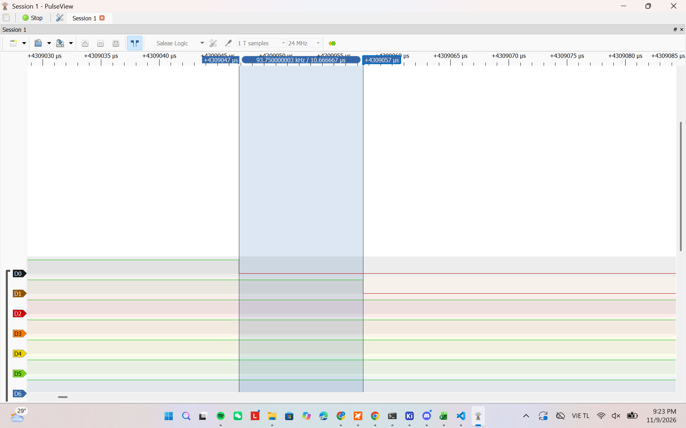
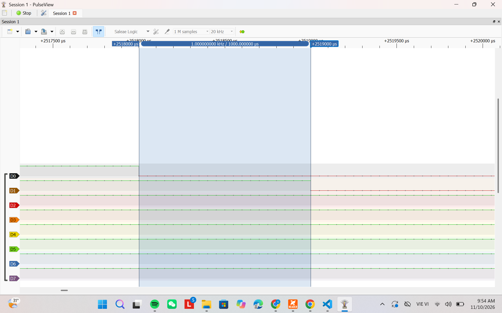

# Report — Week 3 / Ex1

`student_id`: 2412477    Commit của PREDICTION.md: ______

## 1. Bằng chứng configASSERT
Mô tả/log/ảnh lúc priority sai (bước 4 README) + giải thích chính xác **vì sao**
assert được kích hoạt (nêu đúng tên macro và điều kiện).
Bởi vì khi chạy ta cấu hình pri là 4 mà stm32f103 đưa 4 bit cao của byte priority nên số 4 đưa vào bị dịch trái 4 bit nên thành 64.
Mà trong freeRTOS được cấu hình bằng 5 được dịch 4 bit nên thành 80.
Ta có 64 >= 80 → sai.
## 2. Latency ISR → task
| Cấu hình | Dự đoán (us) | Đo được (us) | Đạt `LATENCY_BUDGET_US`? |
|---|---|---|---|
| Có `portYIELD_FROM_ISR` | 10,67 us| Đạt | |
| Không có `portYIELD_FROM_ISR` | | | |

Ảnh logic analyzer đính kèm cho cả 2 cấu hình.

## 3. Giải thích quan hệ priority
Giải thích bằng lời của bạn: số NVIC priority nhỏ/lớn nghĩa là gì, vì sao
`configLIBRARY_MAX_SYSCALL_INTERRUPT_PRIORITY` tồn tại, điều gì xảy ra nếu một
ISR ưu tiên cao hơn ngưỡng này gọi API FreeRTOS.

Số NVIC priority nhỏ nghĩa là mức ưu tiên nó càng lớn.
`configLIBRARY_MAX_SYSCALL_INTERRUPT_PRIORITY` cần thiết vì freeRTOS cần đảm bảo khi nó đang thao tác với các cấu trúc kernel thì k có được một isr quá ưu tiên xen vào làm hỏng dữ liệu.

## 4. Lệch so với dự đoán
Mỗi mục lệch + nguyên nhân vật lý (jitter NVIC, pipeline, v.v.).
Dự đoán 2.5us trong khi đo được khoảng 10.67us cao hơn khoảng 8.17us. Dự đoán ban đầu đã đánh giá thiếu chi phí của đường xử lý thực tế: vào ngắt, xử lý HAL/callback, kiểm tra priority, notification, chuyển ngữ cảnh, trở về task và thao tác GPIO. Ngoài ra, số lệnh không đồng nhất với số chu kỳ CPU; truy cập bộ nhớ và Flash wait state cũng có thể ảnh hưởng. Chưa có phép đo tách từng phần để xác định chính xác đóng góp của mỗi nguyên nhân. Mẫu này vẫn nhỏ hơn ngân sách 80 µs.
## 5. Câu hỏi đánh đổi
Nếu tăng `ISR_NVIC_PRIO` của bạn lên một bậc (ưu tiên thấp hơn) trong khi vẫn
hợp lệ, latency đo được thay đổi bao nhiêu? Trả lời bằng số đo thật, không
đoán.
Nếu hạ thấp xuống 10 thì số đo được là khoảng 10us lệch 0.67us so với khi priority là 7.