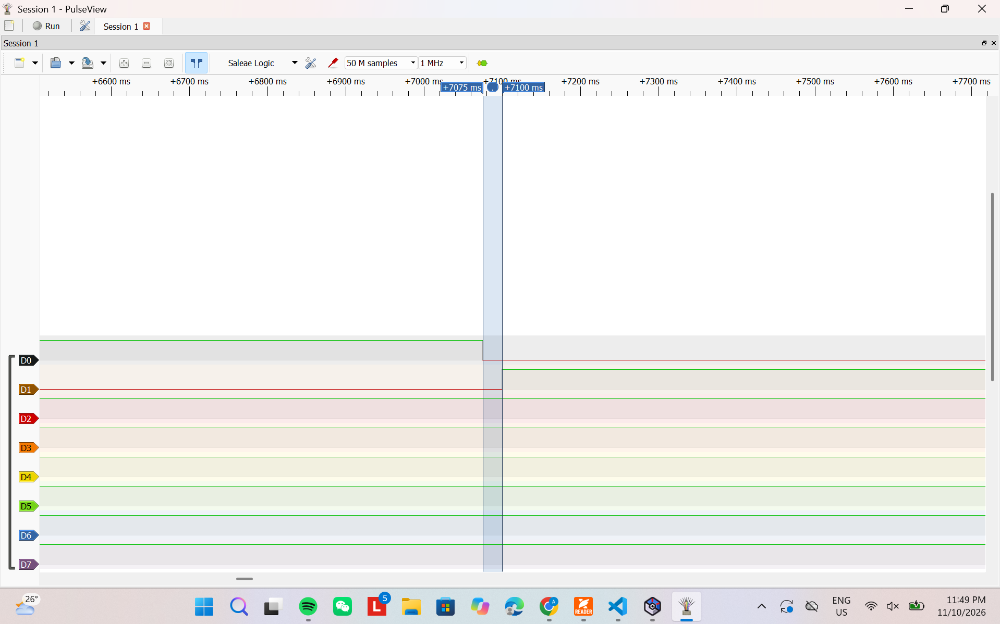
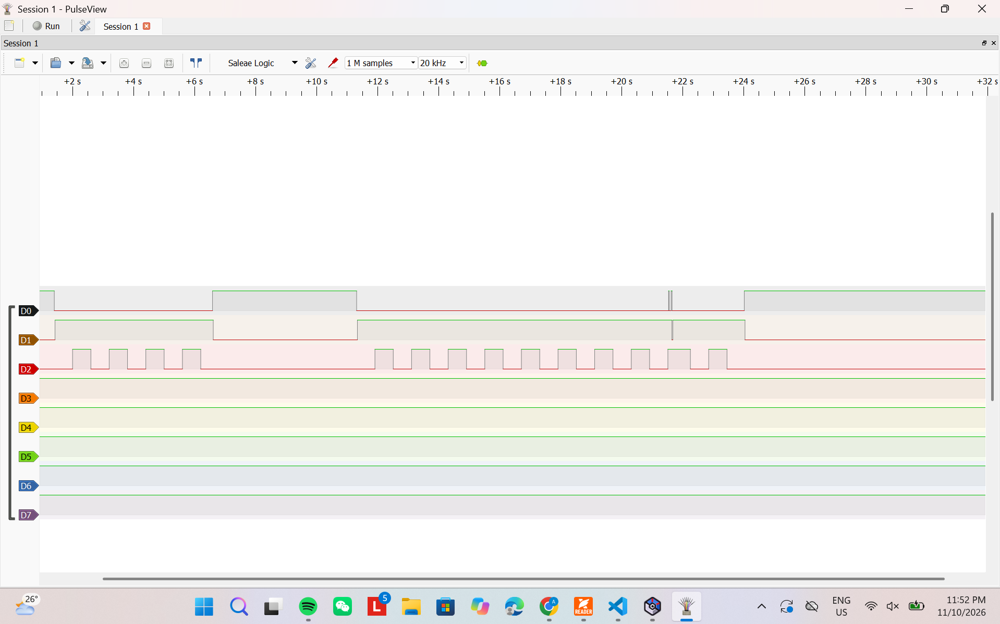
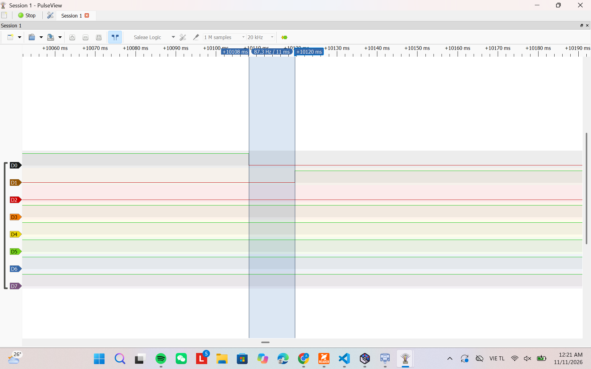

# Report — Week 3 / Ex2

`student_id`: 2412477    Commit của PREDICTION.md: ______

## 1. Nảy phím trước/sau
Ảnh logic analyzer: tín hiệu thô (nhiều cạnh nảy) và tín hiệu "PRESS" sau khi
qua `debounce_timer` (một cạnh sạch).

## 2. Callback bị block — thí nghiệm bước 4
| | Dự đoán | Đo được |
|---|---|---|
| Độ trễ `longpress_callback` khi `debounce_callback` block 50ms | Không trễ | Tùy vào case |

Log timestamp (`xTaskGetTickCount()`) của cả hai callback quanh lúc bị block.
PRESS tick=295557 ms=295557
RELEASE tick=295607 ms=295607
PRESS tick=295728 ms=295728
HELD tick=296328 ms=296328
RELEASE tick=296945 ms=296945
PRESS tick=323437 ms=323437
HELD tick=324012 ms=324012
HELD tick=324612 ms=324612
HELD tick=325212 ms=325212
RELEASE tick=325384 ms=325384
PRESS tick=326052 ms=326052
HELD tick=326627 ms=326627
RELEASE tick=326758 ms=326758
PRESS tick=327454 ms=327454
RELEASE tick=328014 ms=328014
PRESS tick=328508 ms=328508
RELEASE tick=328842 ms=328842
PRESS tick=329320 ms=329320
HELD tick=329895 ms=329895
RELEASE tick=330049 ms=330049
PRESS tick=330461 ms=330461
HELD tick=331036 ms=331036
RELEASE tick=331104 ms=331104
PRESS tick=331715 ms=331715
HELD tick=332290 ms=332290
RELEASE tick=332346 ms=332346
PRESS tick=332927 ms=332927
HELD tick=333502 ms=333502
RELEASE tick=333644 ms=333644
PRESS tick=340711 ms=340711
HELD tick=341286 ms=341286
HELD tick=341886 ms=341886
HELD tick=342486 ms=342486
HELD tick=343086 ms=343086
HELD tick=343686 ms=343686
HELD tick=344286 ms=344286
HELD tick=344886 ms=344886
HELD tick=345486 ms=345486
HELD tick=346086 ms=346086
HELD tick=346686 ms=346686
HELD tick=347286 ms=347286
HELD tick=347886 ms=347886
HELD tick=348486 ms=348486
HELD tick=349086 ms=349086
HELD tick=349686 ms=349686
HELD tick=350286 ms=350286
HELD tick=350886 ms=350886
HELD tick=351486 ms=351486
RELEASE tick=352057 ms=352057
## 3. Giải thích daemon task
Giải thích **bằng cơ chế**, không chỉ hiện tượng: vì sao một callback block sẽ
ảnh hưởng timer khác, liên hệ đến timer command queue và việc có đúng MỘT
daemon task xử lý tất cả software timer.
Khi chỉ có 1 daemon task xử lý toàn bộ software timer thì chính nó khi bị blocked sẽ làm chậm các task khác không thể nhận task từ queue để xử lý mặc dù đúng hạn và chỉ khi running trở lại thì task trong queue mới được xử lý tiếp.
## 4. Long-press
Thời gian giữ thực tế đo được so với `LONGPRESS_MS`: khớp không?
Có khớp 

## 5. Lệch so với dự đoán
Mỗi mục lệch + nguyên nhân.
Ảnh debounce_timer.png cho thấy cạnh xuống PB11 tại khoảng 7075 ms và cạnh lên PA8 tại khoảng 7100 ms, tương ứng thời gian phản hồi khoảng 25 ms, phù hợp với DEBOUNCE_MS = 25.

Tuy nhiên, ảnh chưa phóng đủ rõ để đo thời gian nảy thực tế. Vì vậy, dự đoán nút nảy trong khoảng 5–10 ms chưa được kiểm chứng.

Trong thí nghiệm thêm delay 50 ms, chưa quan sát thấy ảnh hưởng rõ lên thời điểm HELD. Điều này phù hợp với trường hợp debounce callback chạy quanh mốc 25 ms, kết thúc delay quanh mốc 75 ms, trước hạn long-press 600 ms. Kết quả này không chứng minh callback được phép block; nó chỉ cho thấy hai khoảng thời gian chưa chồng nhau.
## 6. Câu hỏi đánh đổi
Với `DEBOUNCE_MS` của bạn, nếu giảm xuống còn một nửa thì tín hiệu sau debounce
còn sạch không? Đo lại trên board của bạn, không suy luận suông.
sau khi còn một nửa thì vẫn có thể còn sạch

