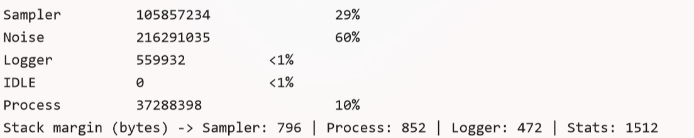
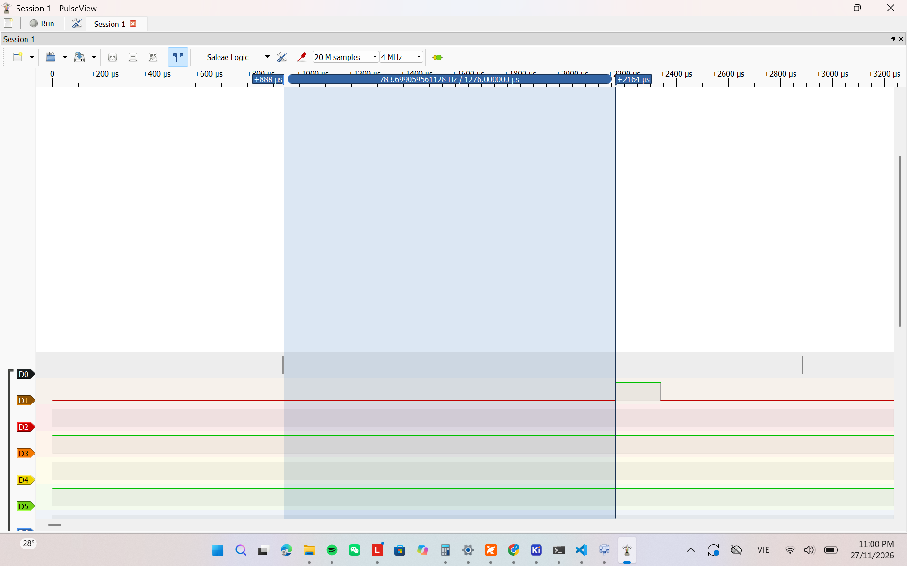

# Report — Week 4 / Ex3

`student_id`: 2412477    Commit của PREDICTION.md: ______

## 1. CPU% / stack HWM từng task
| Task | CPU% | Stack HWM (bytes còn trống) |
|---|---|---|
| sampler ISR / task xử lý | 29% |796 |
| logger_task | <1% |472 |
| measure_task | < 1%| 1512|

Ảnh log UART đính kèm.

## 2. Cách tạo tải cao nhất
Mô tả task nhiễu / cơ chế ép worst-case đã dùng.
Cơ chế tạo task noise là khi tạo một task có priority bằng process task và cho nó vào trạng thái busy wait để mô tả ăn cpu cao nhất.
## 3. Latency worst-case vs deadline
| | Dự đoán | Đo được | Đạt `ISR_TO_PROC_DEADLINE_US`? |
|---|---|---|---|
| Latency ISR→xử lý (worst-case) | 300 us|1,276 us | Không đạt|

Ảnh logic analyzer đính kèm.

## 4. Phân tích (nếu không đạt)
Nguyên nhân cụ thể + đề xuất sửa (không bắt buộc phải sửa, chỉ cần phân
tích đúng).
Sự khác biệt nằm ở cơ chế tranh chấp của noise_task và thời gian i2c polling quá lâu.
## 5. Lệch so với dự đoán
Mỗi mục lệch + nguyên nhân.
Như trên ạ.
